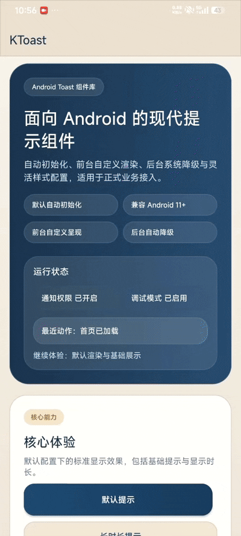

# KToast

[](https://central.sonatype.com/artifact/io.github.logan0817/ktoast)
[](https://developer.android.com/about/versions/android-5.0)
[](LICENSE)

[English](README_EN.md) · [快速开始](#快速开始) · [Compose](#compose-可选扩展) · [下载 Demo](https://github.com/logan0817/KToast/releases/tag/1.3.0) · [完整文档](docs/README.md)

KToast 是一个 Android Toast 提示库，支持 Kotlin 和 Java。用一行代码显示短暂提示，也可以选择成功、失败等内置样式，调整外观和回弹动画，或让提示随页面离开自动取消。

**当前正式版：1.3.0，已发布到 Maven Central，支持 Android 5.0（API 21）及以上。** 默认自动初始化，无需悬浮窗权限。核心库不依赖 Compose、Material 或协程；Fragment 和 Compose 接入可按需添加扩展。

| 想做什么 | 从这里开始 |
| --- | --- |
| 先显示一条提示 | [快速开始](#快速开始) |
| 显示成功、失败、警告或信息样式 | [内置提示样式](#内置提示样式) |
| 页面离开后自动取消提示 | [选择提示入口](#选择提示入口) |
| 在 Compose 页面中使用 | [Compose 示例](#compose-可选扩展) |
| 调整颜色、图标、位置或动画 | [自定义外观](#自定义外观) |
| 先在手机上体验 | [下载 1.3.0 Demo APK](https://github.com/logan0817/KToast/releases/download/1.3.0/KToast-Demo-1.3.0.apk) |

## 快速开始

### 安装

**1. 确认依赖仓库包含 Maven Central。** 在项目的 `settings.gradle.kts`（Groovy 项目为 `settings.gradle`）中检查下面的配置；已经存在就不用重复添加：

```kotlin
dependencyResolutionManagement {
    repositories {
        google()
        mavenCentral()
    }
}
```

**2. 在应用模块（通常是 `app`）的 `build.gradle.kts` 中添加核心库：**

```kotlin
dependencies {
    implementation("io.github.logan0817:ktoast:1.3.0")
}
```

如果文件名是 `build.gradle`，使用 Groovy 写法：

```groovy
dependencies {
    implementation 'io.github.logan0817:ktoast:1.3.0'
}
```

**3. 点击 Android Studio 的 Sync Now，等待依赖同步完成。** 无需复制库源码，也无需在 `Application` 中额外初始化。只有主动关闭自动初始化时，才需要[手动初始化](docs/PAGE_SCOPE.md#接入与生命周期)。

### 快速使用

在现有页面的按钮点击等事件中调用：

```kotlin
import com.logan.ktoast.toast

// 放在点击回调或其他需要反馈的位置。
"保存成功".toast()
```

Java 使用同一个核心库：

```java
import android.widget.Toast;
import com.logan.ktoast.KToast;

// 放在点击回调或其他需要反馈的位置。
KToast.show("保存成功", Toast.LENGTH_SHORT);
```

运行应用并触发事件，即可看到提示。普通入口默认显示短提示；连续调用时，默认用新提示替换旧提示。[排队展示](docs/USAGE.md#3-队列展示)需要显式开启。

## 内置提示样式

1.3.0 提供成功、失败、警告和信息样式，自动搭配图标与日夜配色，不用自己设置颜色：

```kotlin
import com.logan.ktoast.KToast
import com.logan.ktoast.config.KToastStyle
import com.logan.ktoast.config.KToastType

// 在对应操作完成后选择其中一种调用。
KToast.showStyled("保存成功", KToastStyle(KToastType.SUCCESS))
KToast.showStyled("保存失败，请重试", KToastStyle(KToastType.ERROR))
```

| 类型 | 适合的提示 |
| --- | --- |
| `SUCCESS` | 保存成功、已复制 |
| `ERROR` | 保存失败、操作失败 |
| `WARNING` | 内容未填写、即将到期 |
| `INFO` | 设置将在下次启动生效 |
| `NORMAL` | 沿用普通外观 |

`showStyled` 返回 `ToastHandle`，用于控制这一次请求。普通提示也可以用 `showHandle` 获取句柄：

```kotlin
import com.logan.ktoast.KToast

val handle = KToast.showHandle("提示内容")
// 后续需要提前关闭这条提示时调用。
handle.cancel()
```

自有品牌颜色、XML 样式和 Java 用法见[样式指南](docs/STYLES.md)。如果提示只属于当前页面，使用下面的页面入口也能调用 `showStyled`。

## 选择提示入口

第一次体验可以使用 `toast()`；实际页面中的提示，建议绑定所属页面，避免离开后仍显示旧消息。“作用域”就是提示所属的页面范围。

| 使用位置 | 依赖模块 | 入口 | 页面离开后的行为 |
| --- | --- | --- | --- |
| 应用全局消息 | `ktoast` | `KToast` / `toast()` | 使用全局规则；后台可尝试系统 Toast |
| Activity 页面 | `ktoast` | `KToastScope` | 页面停止时取消，回来后可继续使用 |
| Fragment 页面 | `ktoast-lifecycle` | `KToastLifecycleScope` | 绑定 View 生命周期，旧 View 销毁后自动关闭 |
| Compose 页面 | `ktoast-compose` | `rememberKToastScope` | 页面停止时取消，离开 Composition 后关闭 |

三个模块都使用 **1.3.0**。扩展会自动引入同版依赖：`ktoast-compose` → `ktoast-lifecycle` → `ktoast`；只用 Compose 时声明 Compose 模块即可，不必把三个模块都添加一遍。所有入口共享同一个串行展示队列。

### Activity 页面

只需核心库。下面是一个无需 XML 布局的完整页面示例：在自己的包名下新建 Activity，按应用原有方式在 Manifest 注册并打开它，点击按钮即可体验。

```kotlin
import android.app.Activity
import android.os.Bundle
import android.widget.Button
import com.logan.ktoast.KToastScope

class ToastExampleActivity : Activity() {
    private lateinit var toastScope: KToastScope

    override fun onCreate(savedInstanceState: Bundle?) {
        super.onCreate(savedInstanceState)
        toastScope = KToastScope.create(this)
        setContentView(Button(this).apply {
            text = "显示提示"
            setOnClickListener { toastScope.show("这条提示属于当前页面") }
        })
    }
}
```

库自动处理页面停止和销毁，无需额外在 `onDestroy` 清理。页面重建时，为新的 Activity 创建新作用域；不要把作用域保存到单例或 ViewModel。输入法避让、主题及 Java 示例见 [Activity 指南](docs/PAGE_SCOPE.md)。

### LifecycleOwner 扩展

Fragment 页面添加以下依赖，它已包含核心库：

```kotlin
dependencies {
    implementation("io.github.logan0817:ktoast-lifecycle:1.3.0")
}
```

在**已有 Fragment** 的 `onViewCreated` 中创建，并为当前 View 绑定事件：

```kotlin
import android.os.Bundle
import android.view.View
import com.logan.ktoast.lifecycle.KToastLifecycleScope

override fun onViewCreated(view: View, savedInstanceState: Bundle?) {
    super.onViewCreated(view, savedInstanceState)
    val toastScope = KToastLifecycleScope.create(requireActivity(), viewLifecycleOwner)
    // 演示将事件绑在根 View；实际项目可以改成自己的按钮。
    view.setOnClickListener { toastScope.show("这条提示属于当前 Fragment 页面") }
}
```

这里使用 `viewLifecycleOwner`，确保旧 View 销毁后提示也取消；View 重建时重新创建。已有 Fragment 工程通常已具备所需宿主和 Fragment 依赖，KToast 扩展本身不添加 Fragment 或 Compose。更多规则见 [Fragment 与 LifecycleOwner 指南](docs/LIFECYCLE_SCOPE.md)。

### Compose 可选扩展

在**已经启用 Compose 的应用**中添加：

```kotlin
dependencies {
    implementation("io.github.logan0817:ktoast-compose:1.3.0")
}
```

在 `ComponentActivity`（或其子类）承载的页面中使用。将下面组件放入现有页面，点击文字显示提示。示例使用 Compose Foundation，请确认应用已有 Foundation 依赖（或已通过现有 UI 依赖引入），版本沿用项目的 Compose 配置，不要求 Material：

```kotlin
import androidx.compose.foundation.clickable
import androidx.compose.foundation.text.BasicText
import androidx.compose.runtime.Composable
import androidx.compose.ui.Modifier
import com.logan.ktoast.compose.rememberKToastScope

@Composable
fun ToastExample() {
    val toastScope = rememberKToastScope()
    BasicText(
        text = "显示提示",
        modifier = Modifier.clickable { toastScope.show("这条提示属于当前 Compose 页面") }
    )
}
```

在点击等事件中调用 `show`，不要直接在 Composable 函数体中显示，否则重组可能重复触发。`showStyled` 和自定义 Composable 内容见 [Compose 指南](docs/COMPOSE.md)；编译器、Compose 依赖和宿主要求也在该指南中。

## 自定义外观

只调整某一次提示时，在调用后面的配置块里设置：

```kotlin
import android.graphics.Color
import android.view.Gravity
import com.logan.ktoast.toast

"自定义提示".toast {
    backgroundColor = Color.parseColor("#2E7D32")
    textColor = Color.WHITE
    gravity = Gravity.CENTER
    yOffset = 0
}
```

默认保留缩放回弹，1.3.0 已修复回弹峰值时的圆角裁剪，并可分别配置入场、退场插值器。继续阅读[动画插值器](docs/USAGE.md#动画插值器130)、[全局配置](docs/USAGE.md#全局样式)或[自定义 View](docs/USAGE.md#6-自定义内容-view)。

## 常见问题

**需要权限或手动初始化吗？** 默认无需额外权限，也无需手动调用初始化；使用 AndroidX App Startup 自动初始化。

**为什么连续调用只看到最后一条？** 默认是替换模式。希望逐条显示时，使用[队列模式](docs/USAGE.md#3-队列展示)；需要过滤重复内容时，使用[去重](docs/USAGE.md#5-窗口内忽略重复消息)。

**页面离开后还想显示吗？** 页面作用域会取消自己的请求，不会转移到其他页面。应用级消息可使用全局入口；后台系统 Toast 可能被限流或拦截，重要后台消息请使用通知。需要用户点击操作的反馈可评估 Snackbar。

**需要复制混淆规则吗？** 通常不需要额外规则；已有三个独立消费者的 R8 验证。遇到依赖或显示问题，按[排障指南](TROUBLESHOOTING.md)检查。

**支持哪些构建环境？** 核心最低 API 21，字节码目标 JVM 1.8、Kotlin metadata 1.9；核心生产依赖为 Kotlin stdlib 1.9.23 和 AndroidX Startup 1.1.1。这不代表任意旧编译器均可用，已验证工具链和平台范围见[验收记录](docs/releases/1.3.0.md)。

## 更多文档与示例

| 需要了解 | 文档 |
| --- | --- |
| 样式、延时、取消、回调、队列与自定义 View | [核心用法](docs/USAGE.md) |
| 成功/失败样式、品牌 XML、日夜配色 | [样式指南](docs/STYLES.md) |
| 页面生命周期、输入法避让、窗口与无障碍适配 | [Activity 指南](docs/PAGE_SCOPE.md) |
| Fragment View 或独立 LifecycleOwner | [LifecycleOwner 指南](docs/LIFECYCLE_SCOPE.md) |
| Compose 页面、自定义内容与 Preview | [Compose 指南](docs/COMPOSE.md) |
| 限制请求积压、等待超时和去重历史 | [运行策略](docs/RUNTIME_POLICY.md)，按需启用，默认不限制 |
| 升级与版本变化 | [CHANGELOG](CHANGELOG.md) |
| 从源码构建、贡献与发布 | [贡献指南](CONTRIBUTING.md) · [发布指南](docs/RELEASING.md) |

[完整文档导航](docs/README.md) · [Demo 源码](app/src/main/java/com/logan/ktoastapp/MainActivity.kt) · [1.3.0 Release 与 APK 校验文件](https://github.com/logan0817/KToast/releases/tag/1.3.0)

Demo 使用开发证书签名，仅供体验示例。以下历史动画展示基础样式，不包含全部 1.3.0 新功能：



## 许可证

KToast 使用 [MIT License](LICENSE)，版权所有 © 2026 Logan Gan。
