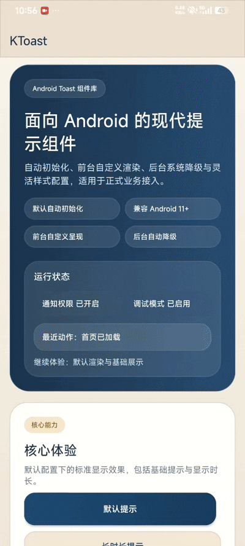

# KToast

[](https://central.sonatype.com/artifact/io.github.logan0817/ktoast)
[](https://developer.android.com/about/versions/android-5.0)
[](LICENSE)

[English](README_EN.md) · [文档](docs/README.md) · [版本变更](CHANGELOG.md) · [贡献指南](CONTRIBUTING.md)

KToast 是支持 Kotlin 和 Java 的 Android 提示库。它提供前台自定义样式、串行队列、去重、可取消请求，以及绑定明确页面的提示作用域。

核心支持 Android 5.0+，不依赖 Compose、Material 或协程。全局提示在后台可尝试系统 Toast；页面提示随宿主停止取消，适合保存成功、上传状态等短暂反馈。需要用户操作的提示应评估 Snackbar，重要后台消息应使用通知。

> 当前正式版本为 **1.2.0**，核心与可选 LifecycleOwner 扩展均已发布到 Maven Central。正式仓库文件、签名及两个独立消费者已验收；逐轮 CI、设备覆盖与限制见 [1.2.0 验收记录](docs/releases/1.2.0.md)。

## 安装

在 `settings.gradle.kts` 的仓库配置中加入 Maven Central：

```kotlin
dependencyResolutionManagement {
    repositories {
        google()
        mavenCentral()
    }
}
```

在应用模块的 `build.gradle.kts` 中添加已发布版本：

```kotlin
dependencies {
    implementation("io.github.logan0817:ktoast:1.2.0")
}
```

Groovy：

```groovy
implementation 'io.github.logan0817:ktoast:1.2.0'
```

默认通过 AndroidX App Startup 自动初始化，无需额外权限，也无需申请悬浮窗权限。关闭本库自动初始化时，须在 `Application.onCreate` 调用 `KToast.init(this)`；[手动初始化说明](docs/PAGE_SCOPE.md#接入与生命周期)包含 Manifest 配置。

## 快速使用

Kotlin：

```kotlin
import com.logan.ktoast.toast

"保存成功".toast()
```

Java：

```java
import android.widget.Toast;
import com.logan.ktoast.KToast;

KToast.show("保存成功", Toast.LENGTH_SHORT);
```

单次样式：

```kotlin
import android.graphics.Color
import com.logan.ktoast.toast

"上传成功".toast {
    backgroundColor = Color.parseColor("#2E7D32")
    textColor = Color.WHITE
    animationDuration = 150L
}
```

默认模式为 `REPLACE`。完整样式、队列、防抖、去重、按组取消、延时、回调及自定义 View 见 [核心用法](docs/USAGE.md)。

## 选择提示入口

| 场景 | 入口 | 页面停止后的行为 | 可用版本 |
| --- | --- | --- | --- |
| 应用全局提示 | `KToast` / `toast` 扩展 | 保留全局控制与后台系统降级规则 | 1.1.0 |
| 消息属于某个 Activity | `KToastScope` | 取消本轮请求；恢复后作用域可复用 | 1.1.0 |
| 消息属于 Fragment View 或独立 Owner | `KToastLifecycleScope` | 关闭旧活动期；恢复只接受新请求 | 1.2.0 |

三个入口共享同一串行展示队列。Activity 作用域示例：

```kotlin
import android.app.Activity
import android.os.Bundle
import com.logan.ktoast.KToastScope

class EditorActivity : Activity() {
    private lateinit var toastScope: KToastScope

    override fun onCreate(savedInstanceState: Bundle?) {
        super.onCreate(savedInstanceState)
        toastScope = KToastScope.create(this)
    }

    // 在页面已启动后的点击等事件中调用。
    fun onSaved() {
        toastScope.show("保存成功")
    }
}
```

Activity 重建后为新实例创建作用域。窗口约束、输入法避让、无障碍时长、主题、Java 示例和线程约定见 [Activity 作用域](docs/PAGE_SCOPE.md)。

## 1.2.0 可选能力

以下 API 可直接使用正式 `1.2.0`。运行策略属于核心库；LifecycleOwner 作用域须添加同版可选扩展。源码开发与本地候选验证见[贡献指南](CONTRIBUTING.md#构建本地候选与消费者)。

### 可选运行策略

在主线程、初始化后、首个请求或延时任务登记前配置：

```kotlin
import com.logan.ktoast.KToast
import com.logan.ktoast.runtime.KToastRuntimePolicy

KToast.setRuntimePolicy(
    KToastRuntimePolicy(
        maxPendingRequests = 32,
        maxQueueWaitMillis = 10_000L,
        maxDedupeEntries = 256
    )
)
```

三个限制默认均为 `null`，保留旧行为。满额时保留旧请求、拒绝新请求，`REPLACE` 也可能拒绝；等待过期不会打断正在显示的提示。示例值仅作演示，详细规则和 `dropReason` 用法见 [运行策略](docs/RUNTIME_POLICY.md)。

### LifecycleOwner 扩展

独立模块坐标为 `io.github.logan0817:ktoast-lifecycle:1.2.0`，传递依赖同版核心和 `lifecycle-common:2.5.1`，不额外引入 Fragment、Compose 或协程。单独接入核心不会引入 Lifecycle。添加扩展时使用同版坐标：

```kotlin
implementation("io.github.logan0817:ktoast-lifecycle:1.2.0")
```

扩展传递依赖同版核心，不必重复声明核心依赖；只需运行策略时使用核心即可。

```kotlin
import com.logan.ktoast.lifecycle.KToastLifecycleScope

// 在 Fragment.onViewCreated 中创建并保存。
val toastScope = KToastLifecycleScope.create(requireActivity(), viewLifecycleOwner)
// 为当前 View 注册事件；在页面已 STARTED 时点击。
view.setOnClickListener { toastScope.show("保存成功") }
```

View 销毁后旧作用域永久关闭，View 重建时重新创建。完整说明见 [LifecycleOwner 作用域](docs/LIFECYCLE_SCOPE.md)。

## 兼容性与行为边界

- 最低运行版本为 API 21，库字节码目标为 JVM 1.8，Kotlin metadata 为 1.9；这些信息不代表任意旧编译器或 AGP 均可用。
- 核心生产依赖为 Kotlin stdlib 1.9.23 和 AndroidX Startup 1.1.1。已验证的消费者组合和平台范围见[验收记录](docs/releases/1.2.0.md)。
- 窗口、内容工厂和回调在主线程执行；局部配置 DSL 在调用线程执行。全局可变样式应在初始化或主线程统一设置。
- `onShow` / `SHOWN` 表示渲染调用返回，系统 Toast 完成时间按本地计时估计，均不保证用户实际看到提示。
- 通常不需要额外混淆规则。接入、系统降级、生命周期和工具链问题见 [排障指南](TROUBLESHOOTING.md)。

## 文档与示例

- [文档导航](docs/README.md)：用户指南、API、维护和设计记录。
- [Demo 源码](app/src/main/java/com/logan/ktoastapp/MainActivity.kt)及[生命周期 Demo](app/src/main/java/com/logan/ktoastapp/LifecycleDemoActivity.kt)：从源码构建当前示例。
- [贡献指南](CONTRIBUTING.md)：环境准备、测试和提交约定。
- [发布指南](docs/RELEASING.md)与[版本路线](docs/ROADMAP.md)。

历史演示动画仅展示基础样式；当前版本的设备验收见上方记录：



## 许可证

KToast 使用 [MIT License](LICENSE)，版权所有 © 2026 Logan Gan。
