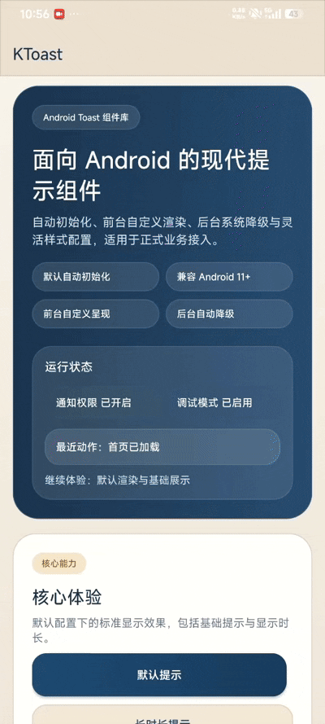

# KToast

[](https://central.sonatype.com/artifact/io.github.logan0817/ktoast)
[](https://developer.android.com/about/versions/android-5.0)
[](LICENSE)

[简体中文](README.md) · [Quick start](#quick-start) · [Compose](#optional-compose-module) · [Download Demo](https://github.com/logan0817/KToast/releases/tag/1.3.0) · [Documentation](docs/README.md)

KToast is an Android toast library for Kotlin and Java. Show a brief message with one line of code, choose built-in success or error styles, customize appearance and bounce animations, or cancel messages automatically when their page stops.

**Current release: 1.3.0, available on Maven Central. Supports Android 5.0 (API 21) and later.** Initialization is automatic and no overlay permission is needed. The core does not depend on Compose, Material, or coroutines; add optional modules for Fragment and Compose integration.

| What do you need? | Start here |
| --- | --- |
| Display your first message | [Quick start](#quick-start) |
| Show success, error, warning, or information styles | [Built-in styles](#built-in-styles) |
| Cancel messages when leaving a page | [Choose an entry point](#choose-an-entry-point) |
| Use KToast in a Compose page | [Compose example](#optional-compose-module) |
| Change colors, icons, position, or animation | [Customize appearance](#customize-appearance) |
| Try the examples on a phone | [Download the 1.3.0 Demo APK](https://github.com/logan0817/KToast/releases/download/1.3.0/KToast-Demo-1.3.0.apk) |

## Quick start

### Installation

**1. Check that Maven Central is in your dependency repositories.** In your project's `settings.gradle.kts` (`settings.gradle` for Groovy), look for this configuration. Do not add it again if it already exists:

```kotlin
dependencyResolutionManagement {
    repositories {
        google()
        mavenCentral()
    }
}
```

**2. Add the core library to your app module's `build.gradle.kts`** (usually in `app`):

```kotlin
dependencies {
    implementation("io.github.logan0817:ktoast:1.3.0")
}
```

If your file is named `build.gradle`, use Groovy:

```groovy
dependencies {
    implementation 'io.github.logan0817:ktoast:1.3.0'
}
```

**3. Click Sync Now in Android Studio and wait for dependency sync to finish.** You do not need to copy library sources or initialize it in `Application`. [Manual initialization](docs/PAGE_SCOPE.md#接入与生命周期) (Chinese) is only required if you deliberately disable automatic initialization.

### Show a message

Call from a button click or another event in an existing page:

```kotlin
import com.logan.ktoast.toast

// Inside a click callback or another event that needs feedback.
"Saved".toast()
```

Java uses the same core dependency:

```java
import android.widget.Toast;
import com.logan.ktoast.KToast;

// Inside a click callback or another event that needs feedback.
KToast.show("Saved", Toast.LENGTH_SHORT);
```

Run the app and trigger the event to see the message. The ordinary entry point uses a short duration by default. Consecutive calls replace earlier messages; [queue mode](docs/USAGE_EN.md#3-queue-mode) must be enabled explicitly.

## Built-in styles

1.3.0 includes success, error, warning, and information styles, with icons and day/night colors:

```kotlin
import com.logan.ktoast.KToast
import com.logan.ktoast.config.KToastStyle
import com.logan.ktoast.config.KToastType

// Choose the appropriate call after an operation completes.
KToast.showStyled("Saved", KToastStyle(KToastType.SUCCESS))
KToast.showStyled("Could not save. Please retry.", KToastStyle(KToastType.ERROR))
```

| Type | Example feedback |
| --- | --- |
| `SUCCESS` | Saved, copied |
| `ERROR` | Could not save, operation failed |
| `WARNING` | Missing content, approaching expiry |
| `INFO` | Settings take effect on next launch |
| `NORMAL` | Keep the ordinary appearance |

`showStyled` returns a `ToastHandle` to control that request. For ordinary messages, use `showHandle`:

```kotlin
import com.logan.ktoast.KToast

val handle = KToast.showHandle("Message")
// Call later if this message needs to close early.
handle.cancel()
```

See the [style guide](docs/STYLES.md) (Chinese) for XML branding and Java usage. The page-scoped entry points below also support `showStyled`.

## Choose an entry point

Use `toast()` to try the library. For messages owned by a page, bind them to that page so they do not appear after you leave. A scope defines which page owns the messages.

| Location | Dependency module | Entry point | When leaving the page |
| --- | --- | --- | --- |
| Application-wide message | `ktoast` | `KToast` / `toast()` | Uses global behavior; may attempt a system Toast in the background |
| Activity page | `ktoast` | `KToastScope` | Cancels on stop; can be used again when the page restarts |
| Fragment page | `ktoast-lifecycle` | `KToastLifecycleScope` | Follows the View lifecycle; closes when the old View is destroyed |
| Compose page | `ktoast-compose` | `rememberKToastScope` | Cancels on stop; closes when leaving Composition |

Use **1.3.0** for all KToast modules. Dependencies are included transitively: `ktoast-compose` → `ktoast-lifecycle` → `ktoast`. A Compose app only needs to declare the Compose module, not all three. All entry points share one sequential presentation queue.

### Activity page

Only the core library is needed. This complete Activity uses no XML layout. Create it in your own package, register it in the Manifest and open it as you would any Activity, then tap the button:

```kotlin
import android.app.Activity
import android.os.Bundle
import android.widget.Button
import com.logan.ktoast.KToastScope

class ToastExampleActivity : Activity() {
    private lateinit var toastScope: KToastScope

    override fun onCreate(savedInstanceState: Bundle?) {
        super.onCreate(savedInstanceState)
        toastScope = KToastScope.create(this)
        setContentView(Button(this).apply {
            text = "Show message"
            setOnClickListener { toastScope.show("This message belongs to this page") }
        })
    }
}
```

The library handles Activity stop and destruction automatically; no extra `onDestroy` cleanup is needed. Create a new scope for a recreated Activity. Do not store it in a singleton or ViewModel. See the [Activity guide](docs/PAGE_SCOPE.md) (Chinese) for IME avoidance, themes, and Java examples.

### LifecycleOwner scopes

For Fragment pages, add the module below. It already includes the core:

```kotlin
dependencies {
    implementation("io.github.logan0817:ktoast-lifecycle:1.3.0")
}
```

Create the scope in an **existing Fragment's** `onViewCreated`, then bind an event to the current View:

```kotlin
import android.os.Bundle
import android.view.View
import com.logan.ktoast.lifecycle.KToastLifecycleScope

override fun onViewCreated(view: View, savedInstanceState: Bundle?) {
    super.onViewCreated(view, savedInstanceState)
    val toastScope = KToastLifecycleScope.create(requireActivity(), viewLifecycleOwner)
    // This demo uses the root View; use your own button in an actual app.
    view.setOnClickListener { toastScope.show("This message belongs to this Fragment page") }
}
```

Use `viewLifecycleOwner` so messages are canceled when the old View is destroyed. Create a new scope when the View is recreated. An existing Fragment app normally already has the host and Fragment dependencies; this KToast module does not add Fragment or Compose. See the [Fragment and LifecycleOwner guide](docs/LIFECYCLE_SCOPE.md) (Chinese).

### Optional Compose module

In an app that **already has Compose enabled**, add:

```kotlin
dependencies {
    implementation("io.github.logan0817:ktoast-compose:1.3.0")
}
```

Use a page hosted by `ComponentActivity` or a subclass. Put this component into your existing page, then tap the text. The example uses Compose Foundation. Ensure your app includes Foundation directly or through its existing UI dependencies, using your project’s Compose version configuration. Material is not required:

```kotlin
import androidx.compose.foundation.clickable
import androidx.compose.foundation.text.BasicText
import androidx.compose.runtime.Composable
import androidx.compose.ui.Modifier
import com.logan.ktoast.compose.rememberKToastScope

@Composable
fun ToastExample() {
    val toastScope = rememberKToastScope()
    BasicText(
        text = "Show message",
        modifier = Modifier.clickable { toastScope.show("This message belongs to this Compose page") }
    )
}
```

Call `show` from click handlers or other events. Do not display a toast directly in the Composable function body, where recomposition could trigger it again. See the [Compose guide](docs/COMPOSE.md) (Chinese) for `showStyled`, custom Composable content, compiler compatibility, dependencies, and host requirements.

## Customize appearance

Use the configuration block to change a single message:

```kotlin
import android.graphics.Color
import android.view.Gravity
import com.logan.ktoast.toast

"Custom message".toast {
    backgroundColor = Color.parseColor("#2E7D32")
    textColor = Color.WHITE
    gravity = Gravity.CENTER
    yOffset = 0
}
```

The default animation includes a scale bounce. 1.3.0 fixes clipped rounded corners at its peak and lets you configure entry and exit interpolators separately. See [animation interpolators](docs/USAGE_EN.md#animation-interpolators-130), [global configuration](docs/USAGE_EN.md#global-style), or [custom Views](docs/USAGE_EN.md#6-custom-content-view).

## Common questions

**Do I need permissions or manual initialization?** No extra permissions or manual initialization are needed by default. AndroidX App Startup initializes the library.

**Why do consecutive calls show only the last message?** Replacement is the default. Use [queue mode](docs/USAGE_EN.md#3-queue-mode) to show each message, or [duplicate filtering](docs/USAGE_EN.md#5-ignore-duplicate-messages-within-a-window) to ignore repeated content.

**Can a message continue after leaving a page?** Page scopes cancel their own requests and do not move them to another page. Use the global entry point for application-wide messages. System Toasts in the background may be limited or blocked; use notifications for important background information. Consider Snackbar for feedback requiring a user action.

**Do I need extra ProGuard rules?** Usually not. Three independent consumers have been verified with R8. See [troubleshooting](TROUBLESHOOTING.md) (Chinese) for dependency or display problems.

**Which build environments are supported?** The core requires API 21+, targets JVM 1.8 bytecode, and uses Kotlin metadata 1.9. Core production dependencies are Kotlin stdlib 1.9.23 and AndroidX Startup 1.1.1. These do not guarantee every older compiler works; see the [verification record](docs/releases/1.3.0.md) (Chinese) for tested toolchains and platforms.

## More documentation and examples

| Topic | Guide |
| --- | --- |
| Styling, delays, cancellation, callbacks, queueing, and custom Views | [Core usage](docs/USAGE_EN.md) |
| Success/error styles, XML branding, day/night colors | [Style guide](docs/STYLES.md) (Chinese) |
| Page lifecycle, IME avoidance, window bounds, and accessibility | [Activity guide](docs/PAGE_SCOPE.md) (Chinese) |
| Fragment Views and independent LifecycleOwners | [LifecycleOwner guide](docs/LIFECYCLE_SCOPE.md) (Chinese) |
| Compose pages, custom content, and Preview | [Compose guide](docs/COMPOSE.md) (Chinese) |
| Pending request limits, waiting expiry, and duplicate history | [Runtime policy](docs/RUNTIME_POLICY.md) (Chinese); optional, with all limits disabled by default |
| Upgrading and release changes | [Changelog](CHANGELOG.md) (Chinese) |
| Building from source, contributing, and publishing | [Contributing](CONTRIBUTING.md) · [Release guide](docs/RELEASING.md) (Chinese) |

[Full documentation index](docs/README.md) · [Demo source](app/src/main/java/com/logan/ktoastapp/MainActivity.kt) · [1.3.0 Release and APK checksums](https://github.com/logan0817/KToast/releases/tag/1.3.0)

The Demo uses a development signing certificate and is intended for trying the examples. This historical animation shows basic styling, not all 1.3.0 features:



## License

[MIT License](LICENSE). Copyright © 2026 Logan Gan.
