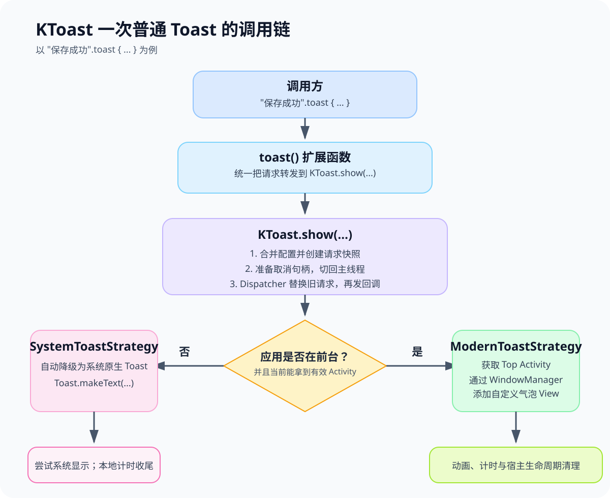

# 文档导航

KToast 的正式版本是 **1.1.0**；**1.2.0** 正在进行本地正式版本准备，尚未发布，验收按提交和运行轮次分别记录。贡献流程继续通过 `-PVERSION=1.2.0-SNAPSHOT` 构建本地候选。逐轮证据与覆盖边界见[验收记录](releases/1.2.0.md)。安装坐标以[项目首页](../README.md)为准，候选功能须先构建本地仓库。

## 使用库

| 文档 | 内容 |
| --- | --- |
| [快速开始](../README.md) / [English](../README_EN.md) | 安装、最小示例、入口选择与兼容边界 |
| [核心用法](USAGE.md) / [English](USAGE_EN.md) | 样式、延时、队列、去重、取消、回调和自定义 View |
| [Activity 作用域](PAGE_SCOPE.md) | 页面停止与恢复、窗口约束、输入法、无障碍、主题和 Java 接口 |
| [运行策略](RUNTIME_POLICY.md) | 1.2.0 候选的容量、等待有效期、LRU 及拒绝原因 |
| [LifecycleOwner 作用域](LIFECYCLE_SCOPE.md) | 1.2.0 候选的独立扩展、Fragment View 绑定及关闭规则 |
| [排障指南](../TROUBLESHOOTING.md) | 提示未显示、策略冻结、生命周期、工具链及设备测试诊断 |
| [版本变更](../CHANGELOG.md) | 已发布版本与待发布变更、兼容及迁移说明 |

## 开发与维护

| 文档 | 内容 |
| --- | --- |
| [贡献指南](../CONTRIBUTING.md) | 项目结构、环境、构建、验证、问题报告与 PR |
| [发布指南](RELEASING.md) | 双模块候选、正式签名、上传、审核与发布后验证 |
| [1.2.0 验收记录](releases/1.2.0.md) | 候选矩阵、产物摘要、覆盖限制及失败记录 |
| [1.1.0 发布归档](releases/1.1.0.md) | 历史验收和正式发布证据，不作为当前操作步骤 |
| [版本路线](ROADMAP.md) | 已交付范围与待评估方向 |
| [1.2.0 设计约束](design/1.2.0.md) | 设计取舍、兼容要求与验收标准 |

## API 与架构

核心 Dokka 模块说明为 [API.md](API.md)，扩展为 [library-lifecycle/API.md](../library-lifecycle/API.md)。生成 API 文档：

```bash
./gradlew :library-android:apiDocsJar :library-lifecycle:apiDocsJar -PVERSION=1.2.0-SNAPSHOT --console=plain
```

HTML 分别位于 `library-android/build/docs/api/index.html` 和 `library-lifecycle/build/docs/api/index.html`，并作为各模块的 `javadoc` 包发布。当前没有承诺另行托管的在线 API 站点。

`api/` 下的 JSON 是机器检查用的公开 JVM API 基线，包含正式 1.0.5、1.1.0 与审阅过的 1.2.0 增量；它们不是接入教程，也不能自动更新为当前扫描结果来消除兼容失败。

基础调用链示意：



该图概览全局与页面提示的共享调度路径；1.2.0 的准入治理和每轮生命周期代理详见[设计约束](design/1.2.0.md)。

## 文档维护约定

- 产品名称为 **KToast**，扩展名称为 **KToast Lifecycle**；坐标使用 `ktoast`、`ktoast-lifecycle`，代码标识符保持既有命名。
- README 提供入门，专题指南解释当前行为，CHANGELOG 记录用户可见变更，发布指南提供当前步骤，逐版本归档保存历史证据。
- 文档默认使用中文；中英文首页与核心示例保持版本、默认值、依赖和行为一致。未翻译专题在英文入口标明语言。
- 保留现有 `README_EN.md`、`docs/API.md` 等已被引用或参与构建的名称；不为格式统一改变公开接口或发布坐标。
- 文件使用可辨识的功能名称；设计与验收记录按版本归档。旧 `NEXT_VERSION_PLAN.md` 保留导航，后续版本不会覆盖旧设计。
- 发布前检查相对链接、代码块、示例符号和版本状态；构建缓存、日志、签名材料、个人环境及临时报告不提交。
