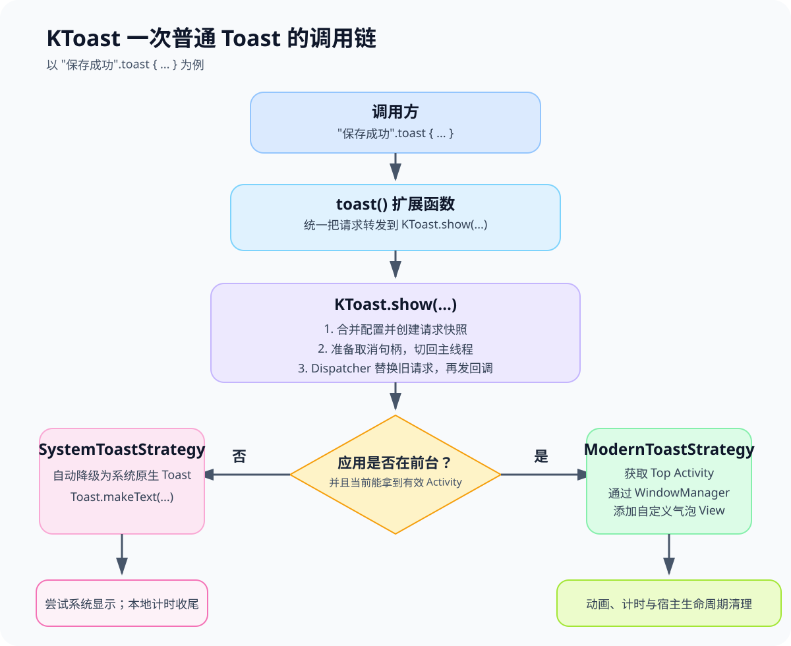

# 文档导航

当前正式版为 **1.3.0**。第一次使用先看[快速开始](../README.md#快速开始)：添加依赖、同步项目，然后在点击事件中显示一条提示。按下面的使用场景继续阅读，无需从头看完全部文档。

## 推荐阅读顺序

1. **先运行起来**：[安装与第一条提示](../README.md#快速开始)。也可以先[下载 Demo](https://github.com/logan0817/KToast/releases/tag/1.3.0)体验。
2. **选择页面入口**：[Activity](PAGE_SCOPE.md)、[Fragment](LIFECYCLE_SCOPE.md)或 [Compose](COMPOSE.md)，让提示在离开页面时自动取消。
3. **调整显示效果**：[内置成功/失败样式与品牌主题](STYLES.md)，以及[颜色、位置和动画](USAGE.md)。
4. **有需要再配置**：[排队、去重、延时和取消](USAGE.md#常见场景)；请求较多时再了解[容量和等待超时](RUNTIME_POLICY.md)。

## 使用库

| 文档 | 内容 |
| --- | --- |
| [快速开始](../README.md) / [English](../README_EN.md) | 安装、最小示例、入口选择与兼容边界 |
| [核心用法](USAGE.md) / [English](USAGE_EN.md) | 样式、延时、队列、去重、取消、回调和自定义 View |
| [语义样式与品牌主题](STYLES.md) | 成功/失败等内置样式、品牌 XML、日夜配色与覆盖顺序 |
| [Activity 作用域](PAGE_SCOPE.md) | 页面停止与恢复、窗口约束、输入法、无障碍、主题和 Java 接口 |
| [LifecycleOwner 作用域](LIFECYCLE_SCOPE.md) | Fragment View 或独立生命周期绑定、停止与关闭规则 |
| [Compose 页面与内容](COMPOSE.md) | 点击事件、页面作用域、自定义 Composable 内容与 Preview |
| [运行策略](RUNTIME_POLICY.md) | 可选的待处理容量、等待超时、去重历史上限及拒绝原因 |
| [排障指南](../TROUBLESHOOTING.md) | 提示未显示、策略冻结、生命周期、工具链及设备测试诊断 |
| [版本变更](../CHANGELOG.md) | 已发布版本与待发布变更、兼容及迁移说明 |

## 开发与维护

| 文档 | 内容 |
| --- | --- |
| [贡献指南](../CONTRIBUTING.md) | 项目结构、环境、构建、验证、问题报告与 PR |
| [发布指南](RELEASING.md) | 三模块候选、正式签名、上传、审核与发布后验证 |
| [1.3.0 验收记录](releases/1.3.0.md) | 正式发布、三模块验证及本机发布方式 |
| [1.2.0 验收记录](releases/1.2.0.md) | 发布结果、CI 矩阵、产物摘要及覆盖限制 |
| [1.1.0 发布归档](releases/1.1.0.md) | 历史验收和正式发布证据，不作为当前操作步骤 |
| [版本路线](ROADMAP.md) | 已交付范围与待评估方向 |
| [1.3.0 设计约束](design/1.3.0.md) | 样式、Compose、动画、兼容要求与验收标准 |
| [1.2.0 设计约束](design/1.2.0.md) | 设计取舍、兼容要求与验收标准 |

使用库时安装 Maven Central 的正式 `1.3.0`。只有贡献源码、验证本地候选时才使用 `-PVERSION=1.3.0-SNAPSHOT`；不要把候选构建步骤当作应用接入步骤。正式发布及后续专项验证证据见 [1.3.0 记录](releases/1.3.0.md)。

## API 与架构

核心 Dokka 模块说明为 [API.md](API.md)，扩展为 [library-lifecycle/API.md](../library-lifecycle/API.md) 和 [library-compose/API.md](../library-compose/API.md)。生成 API 文档：

```bash
./gradlew :library-android:apiDocsJar :library-lifecycle:apiDocsJar :library-compose:apiDocsJar -PVERSION=1.3.0-SNAPSHOT --console=plain
```

HTML 分别位于 `library-android/build/docs/api/index.html`、`library-lifecycle/build/docs/api/index.html` 和 `library-compose/build/docs/api/index.html`，并作为各模块的 `javadoc` 包发布。当前没有承诺另行托管的在线 API 站点。

`api/` 下的 JSON 是机器检查用的公开 JVM API 基线，包含正式 1.0.5、1.1.0、1.2.0 及审阅过的 1.3.0 精确增量；它们不是接入教程，也不能自动更新为当前扫描结果来消除兼容失败。

基础调用链示意：



该图概览全局与页面提示的共享调度路径；1.2.0 的准入治理和每轮生命周期代理详见[设计约束](design/1.2.0.md)。

## 文档维护约定

- 产品名称为 **KToast**，扩展名称为 **KToast Lifecycle** 和 **KToast Compose**；坐标使用 `ktoast`、`ktoast-lifecycle`、`ktoast-compose`，代码标识符保持既有命名。
- README 提供入门，专题指南解释当前行为，CHANGELOG 记录用户可见变更，发布指南提供当前步骤，逐版本归档保存历史证据。
- 文档默认使用中文；中英文首页与核心示例保持版本、默认值、依赖和行为一致。未翻译专题在英文入口标明语言。
- 保留现有 `README_EN.md`、`docs/API.md` 等已被引用或参与构建的名称；不为格式统一改变公开接口或发布坐标。
- 文件使用可辨识的功能名称；设计与验收记录按版本归档。旧 `NEXT_VERSION_PLAN.md` 保留导航，后续版本不会覆盖旧设计。
- 发布前检查相对链接、代码块、示例符号和版本状态；构建缓存、日志、签名材料、个人环境及临时报告不提交。
